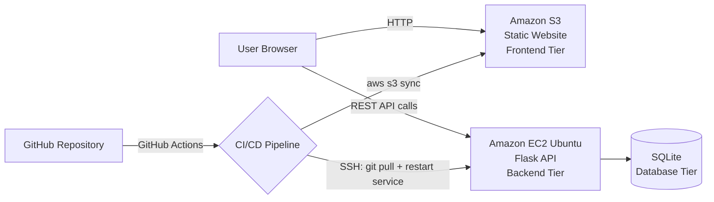

# Multi-Tier Web Application with CI/CD on AWS

A 3-tier cloud application (frontend, backend, database) deployed on AWS, with a fully automated CI/CD pipeline built using GitHub Actions. Every push to the `main` branch deploys both the frontend and the backend automatically.

## Live Demo

**Frontend (S3 static website):** http://karabasu-notes-frontend-2026.s3-website-us-east-1.amazonaws.com/

**Backend API (EC2):** http://184.193.155.254:5000/api/notes

Open the live link, type a note and click **Add**. The note is stored in the database on the server and is still there after a page refresh.

## Architecture



| Tier | Technology | Where it runs |
|---|---|---|
| Frontend | HTML, CSS, JavaScript | Amazon S3 (static website hosting) |
| Backend | Python, Flask, Flask-CORS | Amazon EC2 (Ubuntu), managed by systemd |
| Database | SQLite | On the EC2 instance |
| CI/CD | GitHub Actions | GitHub-hosted runners |

## Features

- Add and list notes through a simple web page
- REST API with `GET` and `POST` endpoints
- Frontend and backend hosted separately (true multi-tier design)
- Backend runs as a `systemd` service, so it restarts automatically after a reboot
- Fully automated deployment on every push to `main`

## Project Structure

```
Cloud-CI-CD/
├── .github/
│   └── workflows/
│       └── deploy.yml        # CI/CD pipeline
├── backend/
│   ├── app.py                # Flask REST API
│   └── requirements.txt      # Python dependencies
├── frontend/
│   └── index.html            # Web page (HTML, CSS, JS)
└── README.md
```

## API Endpoints

| Method | Endpoint | Description |
|---|---|---|
| `GET` | `/api/notes` | Returns all notes as JSON |
| `POST` | `/api/notes` | Adds a note. Body: `{"text": "your note"}` |

Example:

```bash
curl -X POST http://184.193.155.254:5000/api/notes \
  -H "Content-Type: application/json" \
  -d '{"text": "hello cloud"}'

curl http://184.193.155.254:5000/api/notes
```

## CI/CD Pipeline

The workflow in `.github/workflows/deploy.yml` runs on every push to `main` and has two jobs:

1. **frontend**: configures AWS credentials and runs `aws s3 sync frontend/` to upload the page to the S3 bucket.
2. **backend**: connects to the EC2 server over SSH, runs `git pull`, installs the dependencies and restarts the `notes` service.

Credentials are stored as encrypted GitHub repository secrets:

| Secret | Purpose |
|---|---|
| `AWS_ACCESS_KEY_ID` | Access key of a restricted IAM user |
| `AWS_SECRET_ACCESS_KEY` | Secret key of that IAM user |
| `S3_BUCKET` | Name of the frontend bucket |
| `EC2_HOST` | Public IP of the EC2 server |
| `EC2_SSH_KEY` | Private key used for the SSH deployment |

The IAM user has a least-privilege policy: it can only read, write and list objects in the frontend bucket.

## AWS Services Used

- **Amazon S3**: static website hosting for the frontend, with a bucket policy that allows public read access only
- **Amazon EC2**: Ubuntu server hosting the Flask API, with a security group allowing SSH (22) and the API port (5000)
- **AWS IAM**: a dedicated deployment user with a minimal S3 policy
- **GitHub Actions**: automated build and deployment

## Run Locally

```bash
git clone https://github.com/Karabasu2004/Cloud-CI-CD.git
cd Cloud-CI-CD/backend
pip install -r requirements.txt
python app.py
```

The API starts on `http://localhost:5000/api/notes`. To test the frontend locally, change the API address inside `frontend/index.html` to `http://localhost:5000/api/notes` and open the file in your browser.


## Future Improvements

- Add Amazon CloudFront in front of S3 and the API for HTTPS and faster delivery
- Move the database from SQLite to Amazon RDS for a fully separate database tier
- Run the backend behind a production WSGI server (Gunicorn) with a load balancer

## Author

**Karabasappa G. Karinagannanavar**
MCA student, S-VYASA Deemed to be University, Bengaluru

GitHub: [Karabasu2004](https://github.com/Karabasu2004)
